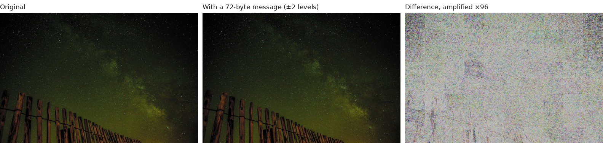

# Ghostframe

Ghostframe hides a short encrypted message in a photo. It nudges the pixels, by at most 2 or 8
levels out of 255 per colour channel, until an off-the-shelf image model (MobileNetV3-Small,
frozen, ImageNet weights) describes the photo with numbers that spell out the message. Reading it
back needs the PNG, the passphrase and the same public model. The original photo is not needed.

Try it in the browser at **[ghostframe.electricsheep.id](https://ghostframe.electricsheep.id)**, or run it
locally (below). It is an engineering experiment, not a product. The method is not new (see
[Related work](#related-work)). What this repository adds is a preregistered benchmark of how
reliably it works on ordinary CPUs, with every raw result committed.



## What works and what doesn't

| Mode | Profile | Message | Change per channel | Held-out trials | Encode (4 vCPU) |
|---|---|---:|---:|---:|---:|
| Subtle | `bb-mobilenet_v3_small-l2-b16p48` | up to 79 B | ±2 levels | 123/123 | median 19 s |
| Long | `bb-mobilenet_v3_small-l8-b64p112` | up to 494 B | ±8 levels | 123/123 | median 33 s |
| Classic | `legacy-v1` (SqueezeNet 1.1) | 13 B | ±8 levels | 41/41 | median 24 s |

"Held-out trials" are on 41 photographs, 1280 px wide, that were fixed in a manifest and never
used to tune any profile (the MobileNetV3 profiles were scored on the same 41 photos after the
SqueezeNet ones). 123 = 41 photos × 3 separately encrypted messages for Subtle and Long; Classic
is 41 photos × 1. A separate decoder process recovered every one exactly. With zero failures in
41 photos, the data still allow a per-photo failure rate of about 7 % (one-sided 95 % bound; 9 %
two-sided); they do not show that it is zero. The demo site calls the Classic mode Short. Subtle and Long also read back 41/41 on
those photos resized to 640 px.

Encode times are the optimisation alone on a shared 4-vCPU server; the command-line tool adds
about 5–15 s to load the model and verify.

Its limits:

- It does not survive edits. It reads exact PNG pixels, so a resize or a crop destroys the
  message, and a JPEG save, even at quality 95, almost always does (1 of 12 Long test files
  survived quality 95; none survived 90). Most messaging apps and social sites do one of these.
- It does not hide that a message exists. A simple detector that knows the public profile
  separates every marked photo from its original (AUC 1.0). This is not steganography in the sense of being
  undetectable. The passphrase keeps the contents private and makes tampering detectable.
- It does not work on every photo. Small, flat or synthetic images can be refused. The encoder then
  writes nothing, rather than a file that will not decode.
- Other hardware may not read the same bits. Decoding was checked on one x86-64 CPU and one
  torch build, with 1 and 4 threads. GPUs and Apple CPUs are untested.

## Try it

Ghostframe needs Python 3.11 or 3.12 and runs on a CPU. From a clone of this repository:

```sh
python3.12 -m venv .venv && . .venv/bin/activate
python -m pip install 'torch==2.7.1+cpu' 'torchvision==0.22.1+cpu' \
  --index-url https://download.pytorch.org/whl/cpu --extra-index-url https://pypi.org/simple
python -m pip install -e '.[tiled]'
```

On Debian/Ubuntu, `python3.12 -m venv` needs the `python3.12-venv` package (or use
`uv venv --python 3.12 --seed .venv`). `uv pip install` works in place of `python -m pip install`;
the other docs use it.

Read a message that is already in one of the sample photos. The first run downloads the
MobileNetV3-Small weights (about 10 MB) and checks their SHA-256.

```sh
printf '%s' 'ghostframe public benchmark fixture' > pass.txt
ghostframe-png decode demo-photos/fixtures/milky-way/subtle.png \
  --profile bb-mobilenet_v3_small-l2-b16p48 --passphrase-file pass.txt
# Signal from the fence line at 02:00. Two flashes mean the road is clear.
```

Hide your own message. This takes about 25 seconds on a 4-core CPU:

```sh
printf '%s' 'Meet at dawn. The north gate stays open until six.' > message.txt
ghostframe-png encode demo-photos/coffee-beans.jpg marked.png \
  --profile bb-mobilenet_v3_small-l2-b16p48 --message-file message.txt --passphrase-file pass.txt
ghostframe-png decode marked.png --profile bb-mobilenet_v3_small-l2-b16p48 --passphrase-file pass.txt
```

Without `--passphrase-file` the commands ask for the passphrase. Decode prints exactly the
message bytes and exits 0; a wrong passphrase, a wrong profile or an unmarked image exits 1 with
no output. `ghostframe-png profiles` lists every profile. The input rules (formats, colour
profiles, minimum size) are in [docs/PNG_PROFILES.md](docs/PNG_PROFILES.md#input-contract).

To check all nine published sample files and their negative controls:

```sh
python -m bench.verify_fixtures --full
```

## How it works

1. The photo is cut into a 10 × 8 grid of tiles.
2. The frozen model turns each tile into an embedding: a list of 576 numbers that describe it.
3. Each tile has a fixed set of directions in that space, derived from the profile name. They
   are public. The sign of the embedding's projection onto each direction is one bit, so a tile
   holds 16 bits (Subtle) or 64 bits (Long).
4. The message is encrypted and authenticated (scrypt, then AES-256-GCM), and Reed–Solomon parity
   is added so that a few wrong bytes can be corrected.
5. The encoder adjusts the pixels with gradient descent, through the model, until every
   projection has the right sign with a safety margin. Each pixel stays within the cap of 2 or 8
   levels per channel. The optimizer works on the rounded 8-bit values, so the saved PNG reads
   back the same.
6. Before writing anything, the encoder saves the PNG to memory, decodes it like a stranger
   would, and checks that it authenticates.

Decoding repeats steps 1 to 3, corrects errors, and decrypts. The model's weights never change.
The frame format and threat model are in [docs/THREAT_MODEL.md](docs/THREAT_MODEL.md).

## Evidence

- [bench/PREREGISTRATION.md](bench/PREREGISTRATION.md) and
  [bench/PREREGISTRATION-BACKBONES.md](bench/PREREGISTRATION-BACKBONES.md): the decision rules.
  The first (rule `9628f4d`, results `3c186e2`, raw records `a633374`) covers the SqueezeNet
  profiles and was committed before any held-out photo was encoded. The second (rule `afceeae`,
  amended in `4fb6e27`, results `6364357`) covers the MobileNetV3 profiles in the table above. It
  reuses the same 41 photos, which had by then been scored for the SqueezeNet profiles. Long was
  the preregistered candidate; Subtle was added by an amendment after screening and before its
  held-out run. The raw records were committed after the runs, so the order is shown by the rule
  commits, not by the records. The history was rewritten once (2026-11-11) to change the author
  email; trees and dates were kept. These timestamps are my own and are not independently
  notarised.
- [docs/BENCHMARK.md](docs/BENCHMARK.md): every result, the 640-px check, the detector, and the
  commands to reproduce them.
- [docs/AUDIT_REPORT.md](docs/AUDIT_REPORT.md): an adversarial review of the earlier prototype's
  claims, including the ones that did not hold up.
- `bench/results/`: the raw per-trial records.

## Related work

Optimising an image so that a frozen network reads out hidden data is an established idea.
[Vukotić, Chappelier and Furon (WIFS 2018)](https://doi.org/10.1109/wifs.2018.8630768)
watermarked images (zero-bit) through a frozen classifier's features.
[Ghamizi et al. (2019)](https://arxiv.org/abs/1912.01487) hid messages in the outputs of
pretrained classifiers using adversarial attacks.
[Fernandez et al. (ICASSP 2022)](https://arxiv.org/abs/2112.09581) used secret random carrier
directions in a self-supervised (DINO) feature space and read bits from projection signs, which
is close to what Ghostframe does with public carriers.
[Kishore et al. (ICLR 2022)](https://openreview.net/forum?id=hcMvApxGSzZ) developed the idea for
steganography (Fixed Neural Network Steganography), and
[Luo et al., "Securing Fixed Neural Network Steganography" (ACM MM 2023)](https://arxiv.org/abs/2309.09700)
added a key. Cornell holds a US patent on adversarial-perturbation steganography with a fixed
decoder ([US 12,033,233](https://patents.google.com/patent/US12033233B2/en)).

Relative to these papers, the differences are practical: tiles with authenticated encryption
and error correction, an encoder that refuses rather than writes a bad file, and a held-out
benchmark on CPU. Error correction itself is standard in learned tools (SteganoGAN ships
Reed–Solomon; StegaStamp and TrustMark use BCH codes). More detail is in
[docs/RESEARCH.md](docs/RESEARCH.md).

## Earlier experiments

Before these profiles, the project tried a raw-bit channel, a tiled SqueezeNet frame (now
`legacy-v1`, the Classic mode), and a conventional JPEG-robust brightness carrier that does not
use a neural network. Their reports, including the negative results, and the commands to rerun
them are in [docs/earlier/](docs/earlier/README.md). The `ghostframe` command and
`python -m experiments.message_cli` belong to that work.

## Demo site

[ghostframe.electricsheep.id](https://ghostframe.electricsheep.id) runs the same engine. Its code is in
`site/` and `server/`; see [site/README.md](site/README.md). Hide is capped at 50 encodes a day for
the whole site and 3 per visitor, and Read at 20 a day per visitor, so running it locally is the
way to try many photos. The demo server sees the photo, message and passphrase you send; they
are processed in memory and dropped when the job ends (privacy details are in the site footer
and in [site/README.md](site/README.md#privacy)).

## Use it responsibly

This is research code. The cryptography has not been audited, the marks are easy to detect, and
any edit to the image loses the message. Do not rely on it to protect anything that matters, and
do not use it to hide anything illegal. To report a security problem, see
[SECURITY.md](SECURITY.md).

## How this was built

I built Ghostframe with Claude Code. Agents wrote most of the code and ran the experiments,
benchmarks and audits; I chose the questions, set the decision rules, and checked the results.

## Licence

The code is MIT-licensed ([LICENSE](LICENSE)). The photos, fonts and model weights keep their own
licences; see [CREDITS.md](CREDITS.md). To cite this work, see [CITATION.cff](CITATION.cff).
